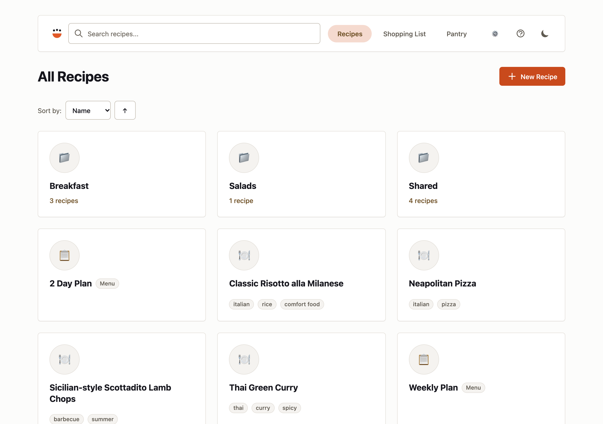
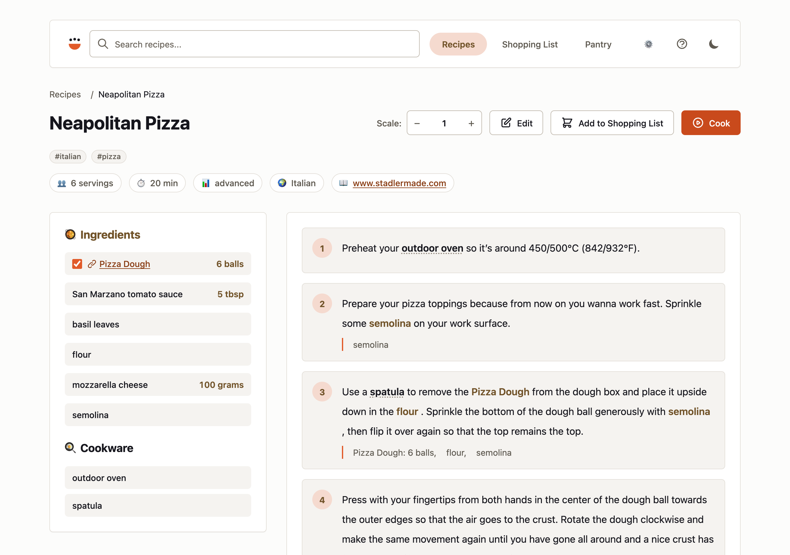
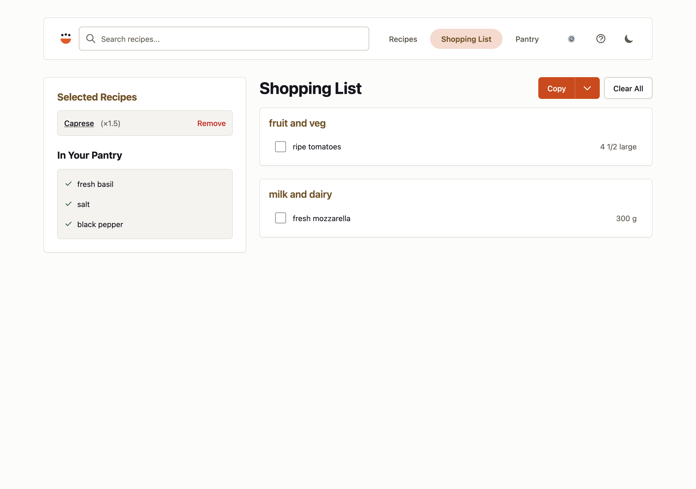
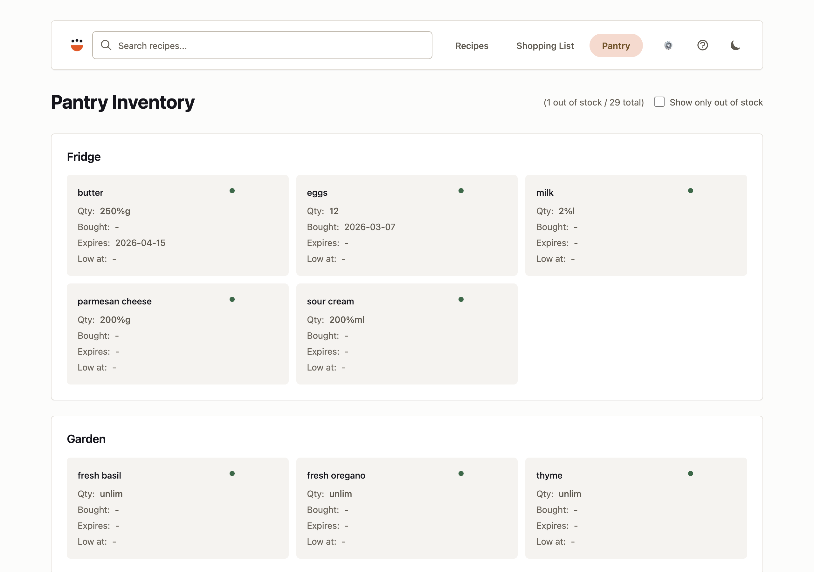

# Server Command

Start a local web server to browse and view your recipe collection.






## Usage

```
cook server [OPTIONS] [BASE_PATH]
cook server user <add|passwd|remove|list> [NAME] [--users-file <PATH>]
cook server hash-password
```

## Arguments

| Argument | Description |
|----------|-------------|
| `[BASE_PATH]` | Root directory containing recipe files (default: current directory) |

## Options

| Option | Description |
|--------|-------------|
| `--host [<ADDRESS>]` | Allow connections from external hosts (default: localhost only). Optionally bind to a specific address. |
| `-p, --port <PORT>` | Port number (default: 9080) |
| `--url-prefix <PREFIX>` | Serve the web UI under a subpath, such as `/cook`, behind a reverse proxy. Every route moves under the prefix, and every link, redirect and cookie the server sends starts with it. |
| `--proxy-strips-prefix` | With `--url-prefix`, for a proxy that removes the prefix before forwarding: routes stay at `/`, while links, redirects and cookies still start with the prefix. See [Behind a proxy that strips the prefix](#behind-a-proxy-that-strips-the-prefix). |
| `--open` | Automatically open the web interface in your default browser |
| `--cors-origin <ORIGIN>` | Origin allowed to make cross-origin browser requests, and whose host the server answers at. Repeatable. `*` lets any origin read. Default: none, same-origin only. |
| `--cors-allow-credentials` | Allow cross-origin requests to carry cookies and credentials. Requires an explicit `--cors-origin`. |
| `--no-csrf-check` | Disable same-origin enforcement: the `Host` check, requests that modify recipes and the editor's language server connection. |
| `--max-lsp-sessions <N>` | Language server sessions to run at once (default: 8). `0` disables the editor's language server. |
| `--users-file <PATH>` | Users who may sign in to make changes. Defaults to `COOK_USERS_FILE`, then `users.toml` in the configuration directory. See [Signing in to make changes](#signing-in-to-make-changes). |
| `--recipes-only` | Show visitors who are not signed in only the recipes: no shopping list, pantry, editor or preferences beyond the language. Signed-in users keep everything their role allows. See [Showing guests only the recipes](#showing-guests-only-the-recipes). |

## Environment

| Variable | Description |
|----------|-------------|
| `COOK_CORS_ORIGIN` | Origins allowed to make cross-origin browser requests, and whose hosts the server answers at, separated by commas. Same values as `--cors-origin`, which overrides it. For containers, where passing a flag means restating the image's whole command. An empty value means "unset". |
| `COOK_RECIPES_ONLY` | `1`, `true` or `yes` turns on `--recipes-only`. Anything else, an empty value included, leaves it to the flag. |
| `COOK_CONFIG_DIR` | Global configuration directory, holding `aisle.conf`, `pantry.conf`, the cook.md session and the sync database. See [the README](../README.md#cook_config_dir). |

No other option can be set this way; `COOK_USERS_FILE` is covered under [Signing in to make changes](#signing-in-to-make-changes). `--no-csrf-check` in particular has to be passed on the command line.

## Examples

```bash
# Start on localhost:9080
cook server

# Serve recipes from a specific directory
cook server ~/my-recipes

# Custom port with auto-open
cook server --port 8080 --open

# Allow access from other devices on the network, which reach it by IP address
# (http://192.168.1.20:9080) and can both read and save
cook server --host

# Only for devices that open the web UI by host name instead: name that origin,
# or the server refuses to answer them
cook server --host --cors-origin http://nas.local:9080

# Let any website read the recipes (but not change them), as 0.37.0 and earlier did
cook server --cors-origin '*'

# Let a frontend at localhost:3000 use the full API, including writes
cook server --cors-origin http://localhost:3000

# Behind a reverse proxy that passes Host through, name the public origin
cook server --cors-origin https://cook.example.com

# At https://example.com/cook/, behind a proxy that forwards the /cook prefix
cook server --url-prefix /cook --cors-origin https://example.com

# The same, behind a proxy that removes /cook before forwarding
cook server --url-prefix /cook --proxy-strips-prefix --cors-origin https://example.com

# Require sign-in before anyone can change recipes
cook server user add alice
cook server --host
```

## Notes

- By default, only accepts connections from localhost
- Use `--host` on trusted networks only — recipes become accessible to anyone on the network, and without [users](#signing-in-to-make-changes) anyone there can change them
- By default the server sends no CORS headers, so a page on another site cannot read anything from it, even though your browser can reach it. `--cors-origin '*'` lets any origin read (`GET`), as 0.37.0 and earlier did by default, while still refusing a cross-origin request that would modify recipes with `403`. Naming origins with `--cors-origin` lets those origins read and write, so a page you have not listed cannot change your recipes. See [the API reference](api.md).
- The server only answers requests sent to `localhost`, an IP address, such as `http://127.0.0.1:9080` or `http://192.168.1.20:9080`, or the host of a `--cors-origin`. Opened at any other host name — `http://nas.local:9080`, or a reverse proxy's `https://cook.example.com` that passes `Host` through — every request is refused with `403` until that origin is named with `--cors-origin`. Otherwise any website could point a domain of its own at your server (DNS rebinding) and read it, or pass for the web UI and change it. This applies to `curl` and other clients too: the `Host` is all the server can go by. The `403` and the server's log name the exact flag to add; only add origins you recognise.
- Behind a reverse proxy that rewrites `Host` to an IP address, such as `proxy_pass http://127.0.0.1:9080`, the check passes on its own, but writes from the web UI still need the public origin named (for example `--cors-origin https://cook.example.com`). The checks read the real `Host` header and ignore `X-Forwarded-Host`, which any client can set freely.
- The recipe editor talks to its language server over a websocket, which browsers exempt from CORS, so the server checks that connection's `Origin` itself, by the same rule: only its own page at `localhost` or an IP address, or a `--cors-origin`, may open it. Under any other host name the editor's completions and diagnostics stop until you name that origin. Whatever a client asks for, the language server only ever sees the directory being served.
- `--no-csrf-check` turns that same-origin enforcement off entirely: the `Host` check, the API, the web UI's new-recipe form and the editor's language server. Its former spelling, `--no-cors`, still works.
- The built-in editor gets its diagnostics and completions from a `cook lsp` subprocess, one per open edit tab, and the endpoint that starts them has no authentication unless [sign-in](#signing-in-to-make-changes) is on. `--max-lsp-sessions` caps how many run at once (8 by default) so that a client which is not that editor cannot spawn them without bound; beyond the cap the websocket handshake is refused with `503` and the editor retries. Under `--host`, consider `--max-lsp-sessions 0`, which serves the recipes but never starts a subprocess for a remote client.
- The web interface supports recipe browsing, scaling, search, editing, and shopping list management
- The server does not follow links out of the recipe directory. A `Linked` folder pointing elsewhere is left out of listings, search and stats, and a request, recipe reference or stored shopping-list entry that resolves through it reads as missing — a linked collection is still yours to share, but the CLI (`cook shopping-list`, `cook report`, `cook doctor`) follows links normally since it runs as you
- A recipe or menu that declares a whole number of `servings` is scaled by servings: the stepper starts at its own servings and goes from half a serving up, with no upper limit (`/recipe/Pizza?servings=3`). Any other keeps the multiplier (`?scale=1.5`, from 0.5 to 200). `?scale=` links still work on both and, on a recipe with servings, show as the servings they give. A menu links each recipe it references by servings when that recipe declares them (`?servings=4`), and by its factor otherwise (`?scale=2`)
- A menu can use another menu as a meal (`- @./Brunches/Sunday.menu{}`): its link opens that menu, marked **Menu**, and **Add All to Shopping List** adds what that menu needs too. The editor's **Add recipe** offers menus as well as recipes
- The UI language is negotiated per request from the browser's `Accept-Language` header — each visitor sees the interface in their own language (supported: `en-US`, `de-DE`, `nl-NL`, `fr-FR`, `es-ES`, `eu-ES`, `sv-SE`, `it-IT`, `ja-JP`, `el-GR`). For static sites, see the `--lang` flag of [`cook build web`](build.md#localization).
- Mobile-friendly responsive layout

## Behind a proxy that strips the prefix

`--url-prefix /cook` assumes the proxy forwards `/cook/recipe/Pizza` as it is, as nginx's `location /cook/ { proxy_pass http://127.0.0.1:9080; }` does. Some proxies remove the prefix instead and forward `/recipe/Pizza`: Traefik's `StripPrefix`, nginx's `proxy_pass http://127.0.0.1:9080/;` (note the trailing `/`), and Home Assistant ingress. Add `--proxy-strips-prefix` for those. The server then answers at `/`, while every link, redirect and cookie it sends still starts with `/cook`, so the browser stays under the proxy's path.

A Home Assistant add-on is shown at `/api/hassio_ingress/<token>/` and can read that path from the Supervisor at start-up:

```bash
cook server /recipes --host --port 8099 \
  --url-prefix "$(bashio::addon.ingress_entry)" --proxy-strips-prefix \
  --cors-origin http://homeassistant.local:8123
```

As with any proxy that rewrites `Host`, saving from the web UI needs the address you open Home Assistant at named with `--cors-origin` (see [Notes](#notes)).

## Containers

The published image runs `cook server /recipes --host`, so nothing extra is needed to open the web UI at `http://localhost:9080`, or at the host's address on the network — both read and save. Reaching it by host name instead, directly or through a reverse proxy, means naming that origin, and `COOK_CORS_ORIGIN` does it without restating the image's command:

```yaml
services:
  cookcli:
    image: ghcr.io/cooklang/cookcli:latest
    ports:
      - "9080:9080"
    volumes:
      - ./recipes:/recipes
    environment:
      COOK_CORS_ORIGIN: https://cook.example.com
```

Name the origin the browser shows, so `https://` when the proxy terminates TLS, and separate several with commas. A container that calls the API from another container by its service name, `http://cookcli:9080`, needs that name too — `COOK_CORS_ORIGIN: https://cook.example.com,http://cookcli:9080` — but nothing else: it sends no `Origin` header.

## Signing in to make changes

Out of the box the server is open: anyone who can reach it can change your
recipes. Add a user, and it asks for sign-in before any change:

```bash
cook server user add alice   # asks for alice's password, twice
cook server
```

Once the server has users:

- Anyone can still browse recipes and menus, search, and look at the shopping
  list and the pantry.
- Creating, editing and deleting recipes, and changing the pantry or the
  shopping list, need a signed-in user whose [role](#roles) allows it. Guests
  see a **Sign in** link at the top of every page instead of the controls
  that change things.
- The editor's language server (`/api/ws/lsp`) is for those who may edit
  recipes, and the CookCloud sync controls for admins only.
- An API request that would change something, sent without a session, gets
  `401`; sent by a user whose role does not allow it, `403`.
  [The API reference](api.md) shows how a script signs in.

Users live on the server only: nobody can sign up or change a password from
the browser.

### Roles

Each user has a role, which decides what they can change once signed in. Each
role can do everything the ones above it can:

| Role | Shopping list & pantry | Recipes & menus (create, edit, delete, pictures) | CookCloud sync |
|------|:---:|:---:|:---:|
| `reader` | | | |
| `shopper` | ✅ | | |
| `editor` | ✅ | ✅ | |
| `admin` | ✅ | ✅ | ✅ |

Everyone, signed in or not, can read. A user added without `--role` is an
`admin`, which is what every user was before roles existed. Pages leave out
the controls a user's role cannot use.

```bash
cook server user add grandma --role reader
cook server user add kid --role shopper
cook server user role kid editor   # applies at once, without signing them out
```

### Showing guests only the recipes

`--recipes-only` (or `COOK_RECIPES_ONLY=1`) turns the server into a cookbook
for anyone who is not signed in. They can browse, search and read recipes and
menus, follow the feeds and pick a language, and nothing else:

- The shopping list and pantry links, the editing controls and the
  **Add to shopping list** buttons are gone, and the preferences page only
  offers the language.
- Every other page and API, including any file in the recipe directory that
  is not a picture, answers as if it needed sign-in: a page sends the browser
  to sign in and back, an API request gets `401`.
- Once signed in, a user gets everything their [role](#roles) allows, as
  without the option.

```bash
cook server user add alice
cook server --host --recipes-only
```

Without users nobody can sign in, so every visitor gets the recipes only, and
the rest of the server answers `404`. That makes a read-only cookbook, for
sharing recipes with people who should not see your shopping list.

### Managing users

| Command | What it does |
|---------|--------------|
| `cook server user add <name> [--role <role>]` | Add a user, asking for their password. Creates the users file if needed. The role defaults to `admin`. |
| `cook server user passwd <name>` | Change a user's password. |
| `cook server user role <name> <role>` | Change a user's [role](#roles). |
| `cook server user remove <name>` | Remove a user. |
| `cook server user list` | List the users and their roles. |
| `cook server hash-password` | Print a password hash, for editing the users file by hand. |

A username may use letters, digits and `_ . @ -`. The password prompt does not
echo what you type. When standard input is not a terminal, the password is
read from its first line instead, for scripts:

```bash
printf '%s\n' "$PASSWORD" | cook server user add alice
```

`user` has to come straight after `server`: in
`cook server --port 8080 user add alice`, `user` is read as the recipe
directory. Pass `--users-file` after the subcommand when you need it.

A running server picks up changes to the users file on its own. A new user can
sign in right away, a new role applies to the user's next request, and
removing a user or changing their password signs them out everywhere. The one
exception is the first user: sign-in turns on when the
server *starts* with a users file, so restart it once after creating one.

### The users file

`cook server` reads `users.toml` from the global configuration directory (see
[Configuration](../README.md#️-configuration)), unless `--users-file <PATH>`
or the `COOK_USERS_FILE` environment variable names another file. The flag
wins, and an empty variable counts as unset. The `user` commands edit the same
file and keep any comments in it.

```toml
# Who may change recipes on this server.
[users]
alice = "$argon2id$v=19$m=19456,t=2,p=1$…"                  # admin
bob = { hash = "$argon2id$v=19$m=19456,t=2,p=1$…", role = "editor" }
```

A bare hash is an admin; a table pairs a hash with a role. `user add` writes an
admin as a bare hash, so a server from before roles still reads the file. It
refuses one with any other role rather than make that user an admin.

- Sign-in is on whenever this file exists when the server starts. Delete it
  and restart to open the server to everyone again.
- An empty `[users]` table keeps sign-in on with nobody able to sign in, which
  makes the site read-only.
- The server will not start with a users file it cannot use — one it cannot
  read, a malformed entry, an unknown role, a file named with `--users-file`
  that does not exist — rather than fall back to letting everyone in. While it runs, an edit
  that breaks the file is ignored: the server logs an error and keeps the
  users it had.
- The server refuses a users file inside the recipe directory, because it
  publishes that directory's files at `/api/static/`.

### Sessions and HTTPS

Signing in sets a `cook_session` cookie that lasts 30 days. The server signs it
with a key it keeps in `auth-secret`, next to `users.toml` in the
configuration directory. Delete that file and restart to sign everyone out.

Signing out ends that session on the server too, so a copy of the cookie left
in another browser or a log stops working; the user's other sign-ins are not
affected. The server records the session in `revoked-sessions`, beside
`auth-secret`, until the cookie would have expired anyway. Deleting that file
brings the signed-out sessions back, so delete `auth-secret` with it. If the
configuration directory cannot be written, the server uses a temporary key,
and everyone has to sign in again after a restart.

Over plain HTTP, passwords and cookies cross the network in the clear. Before
exposing the server beyond a network you trust, put it behind a reverse proxy
that serves HTTPS, and have the proxy send `X-Forwarded-Proto: https` so the
cookie is marked `Secure`.

In a container, give the server a configuration directory it can write to;
see [Sign-in in a container](../README.md#sign-in-in-a-container).

## Activity log

The server prints a line on standard output for every change made through it,
saying when, who, and what — in the terminal, or in `docker logs`:

```text
2026-09-27 08:41:56 alice signed in
2026-09-27 08:42:03 alice created recipe "Soups/Pea soup.cook"
2026-09-27 08:42:40 alice updated recipe "Soups/Pea soup.cook"
2026-09-27 08:43:12 alice added "Soups/Pea soup.cook" ×2 to the shopping list
2026-09-27 08:43:30 alice checked off "flour" on the shopping list
2026-09-27 08:44:05 alice removed "milk" from the "dairy" section of the pantry
2026-09-27 08:45:51 alice deleted menu "Week.menu"
2026-09-27 08:46:00 alice signed out
2026-09-27 09:12:44 guest failed to sign in
```

It covers recipes and menus (created, updated, deleted, title or step picture
set or removed), the shopping list, the pantry, linking the server to cook.md, and
signing in and out. Changes are attributed to the signed-in user; without
[sign-in](#signing-in-to-make-changes), and for a failed sign-in, to `guest`.
A failed sign-in never shows the name that was typed, since that is sometimes
the password. Names and paths are quoted, so a line break in one cannot pass
for another line. Times are the server's local time. The container image has
no time zone data, so it logs in UTC unless you mount the host's zone, e.g.
`-v /etc/localtime:/etc/localtime:ro`.

Changes made to the files directly, outside the server, are not listed.

## Meal plans

Any menu with sections on two days or more is a meal plan, laid out as a calendar. A section is for a day when its name holds a `YYYY-MM-DD` date, as the **Today's menu** banner reads it:

```
---
title: October fortnight
servings: 2
---

== Wednesday (2026-10-07) ==

Breakfast: \
-

Dinner: \
- @./Risotto{2%servings}

= 2026-10-08 Dinner

- @./Soup{}
```

- Nothing else marks a plan: the shopping list, `cook shopping-list` and other Cooklang apps read it as they read any menu. Several sections may share a day. Text after the date names the meal for the section's lines before its first meal header, so `= 2026-10-08 Dinner` is a dinner.
- **New Meal Plan**, beside **New Menu** on the recipe list, writes one: pick its first day (any day of the week), how many days it lasts (2 to 62), its meals and its servings. It has a section for every day, with an empty bullet under each meal to fill in the editor; day and meal names are written in the page's language.
- The plan shows as one card a day, from its first dated day to its last, in weekday columns on a wide screen (weeks start on Sunday for `en-US` and `ja-JP`, Monday otherwise) and one under the other on a phone. A day with no section still gets a card, but a week with none is left out. Every day offers a slot for each meal the plan's days name (`Breakfast:`), in the order they first appear, even when nothing is planned. The reader's own clock marks today and greys the days gone by.
- A section with no date is listed under **Outside this plan**. A menu with a single dated day shows as an ordinary menu.
- Those who may edit recipes can change a plan from its calendar:
  - **+** beside a meal opens the recipe picker and adds the recipe at the end of that meal, as `- @./Folder/Recipe{2%servings}` (servings start at the plan's own). A missing day or meal is written for it: days in date order, meals in the order the plan's days name them.
  - **⋯** beside a line opens **Move to…**, **Copy to…** and **Remove**. Move and Copy ask for a day and a meal. A line can also be dragged onto another meal; holding Alt, Ctrl or ⌘ copies it instead.
  - Only the lines concerned change: comments, notes and the rest of the file are left as they are. Removing a meal's only line leaves an empty bullet, so the meal keeps its slot.
  - The page reloads after each change. If the plan was changed elsewhere since the page was loaded (in the editor, another tab, or on disk), the change is refused and the page asks for a reload, rather than overwrite it.
  - A meal whose lines the calendar cannot match one for one with the file, such as one with free text between bullets, can still be added to, but its lines are only changed in the editor. The calendar uses [`POST /api/plans/{*path}`](api.md).
- **Some days to the shopping list.** Those who may change the shopping list get a checkbox on each day, with **All**, **Next 7 days** and **None** shortcuts, and **Add days to shopping list**. Only those days' recipes go on the list, at the plan's servings, and the ingredients written straight into those days (`@almonds{50%g}`) go on as items of their own, added up when several days name them. **Add All to Shopping List** still adds the whole plan as one entry. Both are written in the `.shopping-list` format the Cooklang apps share: the days' recipes as ordinary recipe lines and their ingredients as free-hand lines, so the list removes them one by one rather than as a menu.

## Web feeds

The server publishes an Atom feed at `/atom.xml`, an RSS 2.0 feed at `/rss.xml` and a [JSON Feed](https://jsonfeed.org/version/1.1) at `/feed.json`, with one item per recipe and menu, newest first. They are built from the recipe files on each request, so they are always up to date. Every page advertises them with `<link rel="alternate">` tags, so a feed reader finds them from the site's address alone.

Items use the same metadata as the static site's feeds (`title`, `date`, `description`, `author`, `tags`); see [Web feeds](build.md#web-feeds). The feed title and language follow the request's `Accept-Language` header.

Feed links are absolute. They are built from the request's `Host` header and `--url-prefix`. Behind a TLS-terminating reverse proxy, send `X-Forwarded-Proto: https` to get `https://` links. As with the same-origin check, `X-Forwarded-Host` is ignored, so the proxy must pass the public `Host` through.

## Title and step pictures

The recipe editor's **Picture** button adds, replaces or removes a recipe's pictures without touching the server's files directly: its title picture — the `Recipe.jpg` next to `Recipe.cook` that the recipe page and the recipe list show — and the picture of each step, shown above the step on the recipe page and in cooking mode. Pick the title or a step in the dialog's **Picture for** list, then choose a file or drop one on the dialog. On the recipe page, the camera button beside a step opens the editor with that step picked; it is shown to those who may edit recipes.

- JPEG, PNG and WebP are accepted. The browser scales a photo down before sending it, so a phone photo of several megabytes goes up as a few hundred kilobytes; the server takes at most 10 MB.
- Every picture is saved as JPEG: turned upright from the photo's orientation data, scaled down to 2048 px on its longer edge, laid over white where it is transparent, and always re-encoded on the server — never stored as sent — so a malformed or doctored file cannot reach the recipe folder.
- Re-encoding drops the photo's metadata, including its GPS location.
- A title picture is saved as `Recipe.jpg`. An older `Recipe.jpeg`, `Recipe.png` or `Recipe.webp` is removed when a new one is saved. Step pictures are never touched.
- A step picture is saved as `Recipe.S.N.jpg`: step N of section S, both counted from 1, as the Cooklang iOS app names them. The recipe page also shows a `Recipe.N.jpg` with the step counted across every section, so saving or removing a step's picture clears both names in every extension. The title picture and other steps' pictures are never touched.
- A step picture belongs to the step's position, not its text: adding or removing an earlier step in the same section moves it onto another step. The dialog saves the recipe before listing its steps, so they are numbered as the recipe page numbers them.
- HEIC and AVIF photos cannot be read by the server. An iPhone's own browser converts a HEIC photo to JPEG as it uploads it, and so does Safari on a Mac; from another browser, export the photo as JPEG first, or set the iPhone camera to **Most Compatible** (Settings › Camera › Formats).
- A recipe whose metadata names a picture (`image:` in its frontmatter) shows that one as its title picture instead. The dialog says so; remove the line to use an uploaded picture.

The dialog uses `/api/recipe_image/{*path}`; see [the API reference](api.md).

## Custom Metadata Families (e.g. Nutrition)

Beyond the [standard Cooklang metadata keys](https://cooklang.org/docs/spec/#canonical-metadata) (`servings`, `time`, `course`, `author`, ...), any YAML frontmatter key whose value is a **list** or a **mapping** is shown on the recipe page as its own line below the tags, grouped by key — one line per family. This works for any such key, not just `nutrition` — e.g. `allergens:` below renders as its own "Allergens" line automatically, with no code changes required.

```yaml
---
tags:
  - vegan
  - gluten-free
nutrition:
  kcal: 258
  proteins: 4.2
  lipids: 4.8
  sugars: 39.4
  fibers: 5.3
file:
  created-by: Yannick
  created-at: 2026-08-20
  modified-by: Yannick
  modified-at: 2026-08-24
allergens:
  - gluten
  - tree nuts
---
```

### Two forms

- **Mapping** (recommended, shown above): `field: value`. A bare number is in the unit of its key for `nutrition` (see [Nutrients](#nutrients): kcal, g, mg or µg). A value may also be written with a unit (`20 g`, `0.4 g`, `1255 kJ`, or `"45.3%g"`): it is converted to the unit of its key.
- **List** (legacy, still supported): `- "258%kcal"`. The `%` is replaced with a space when displayed (`258 kcal`); entries without a `%` are shown as-is. Because list entries are free text, they aren't translated — write them in whichever language you want displayed.

### Hiding a family or a single entry

Prefix a key with `.` to hide it from the recipe page: `.internal-notes:` hides the whole family, and `.lipids:` (inside `nutrition:`) hides just that one entry while the rest of the family still shows. `tags` is never treated as a custom family — it keeps its own dedicated row above, and can't be hidden this way.

### Specific renderers: `nutrition` and `file`/`meta`

Two families get dedicated icons and (for `nutrition`) localized labels, matched on their fields:

- **`nutrition`**: `kcal`/`cal`/`energy` (flame), `proteins` (meat), `lipids`/`fat` (droplet), `saturated-fat` (filled droplet), `carbohydrates`/`carbs` (bread), `sugars` (candy), `fibers`/`fibre` (wheat), `salt`/`sodium` (salt shaker). The nutrient name (everything but `kcal`, which needs none) is translated into the viewer's UI language — see [Localization](build.md#localization) for the supported locales.
- **`file`** (or `meta`, both work): `created-by`/`created-at`/`modified-by`/`modified-at` — person, calendar, pencil, and history icons respectively, with a translated `"Label: value"` line (e.g. `"Modified at: 2026-08-24"`, `"Modifié le : 2026-08-24"` in French, with the French space before `:`).

Every other family (like `allergens` above) falls back to a generic rendering: list entries as-authored, mapping entries as `"field: value"`, no icon. Adding a third specific renderer means adding a case in `src/web/family_renderers/mod.rs`'s `renderer_for` plus a small renderer file next to `nutrition.rs`/`file.rs` — there's no filename-based auto-discovery (Rust has no runtime filesystem scanning for this), so that match statement is always the definitive list of which families get special treatment.

### Nutrition table: per serving, per 100 g, whole recipe

When `nutrition:` is a mapping of numbers, the recipe page shows it as a table instead of a line of icons, with the values you wrote (per serving) next to the same values for the whole recipe at the servings the page is scaled to:

```yaml
servings: 4
weight: 900g        # the whole recipe, as written; adds the "per 100 g" column
nutrition:          # values per serving
  kcal: 258
  proteins: 4.2
```

- **Per serving** is what you wrote. It does not change with the servings stepper.
- **Whole recipe** is the per-serving value times the servings shown, so it follows the stepper (`?servings=6`). A recipe without `servings` counts as one serving, scaled by `?scale=`.
- **Per 100 g** needs `weight:`, the weight of the whole recipe at its own `servings` (`900g`, `"0.9 kg"` or a bare number of grams). It is the per-serving value times `servings`, divided by the weight, so it does not change with the stepper either. Without `weight:` the column is left out.
- The list form (`- "258%kcal"`) keeps the plain line of icons.

What the page shows, for the servings chosen: a donut with the energy in the middle and, when carbohydrates, fat and proteins are all given, their share of the energy; the three macros with their weight and share; and a small card for the nutrients the standard singles out (saturated, mono and polyunsaturated fat, omega-3, trans fat, cholesterol, sugars, starch, fibre and salt, or sodium where the label gives it), those the recipe gives. Every label of the panel, the legend included, is translated. Clicking a slice of the donut highlights what belongs to it (saturated fat under fat, sugars under carbohydrates) in the cards and in the table, and dims the rest; clicking a colour of the legend does the same for the cards and rows with that rating. A plain click picks only that one; **Ctrl, Cmd or Shift** (on a touch screen, every tap) adds or removes one, and slices and ratings combine: a row stays lit when it passes both. A second click on the only one picked, or Escape, clears it.

**Explanation bubbles**: hovering, focusing or tapping a card or a row opens a bubble with what the nutrient is, what it is for and where it is found, then, by the standard in use, its reference intake and how it rates it, and the recipe's figure with its share of the intake. Each text names its source (WHO, NHS, the regulations) in a `nutrition-help-<nutrient>-source` message, and a nutrient whose text has not been sourced yet shows no explanation and says "Source: to be documented". The texts are Fluent messages like the rest (`nutrition-help-<nutrient>-what`, `-use`, `-where`).

**The standard decides how it is laid out and rated** (see [Standards](#standards-tree-reference-intakes-and-ratings)). Nothing about the layout is written in the page code:

- **The tree of the table** comes from the standard. Energy first, then the families Macronutrients, Other components, Minerals and Vitamins, each holding what the recipe gives, nested as the norm nests them. The fibre sits next to the carbohydrates under the EU and the UK, inside them under the US; the carbohydrates are shown without the fibre where the norm gives them so, since the recipe's own figure [counts it in](#nutrients). What the standard's tree does not know stays visible, in a family called "Other data".
- **The percentages** next to a per-serving value are the share of the standard's reference intake (the EU's 800 mg of calcium, the US's 1300 mg). A nutrient the standard has no reference for shows none.
- **The cards are coloured by the standard's rating**: the UK's traffic lights per 100 g (green, amber, red), the EU's claims (a food that earns "low in sugars" or "source of fibre" is green, nothing is ever red), the US's share of the daily value per serving (5 % or less is low, 20 % or more is high; what is to limit is red when high, what is to get more of is green when high). Per-100 g ratings need `weight:`; without it those cards are blue (no rating). The legend under the cards says which colours are in use and how the standard rates.
- **Vitamins and minerals well present** get tiles of their own ("rich in", "source of") by the standard's rule: from 15 % and 30 % of the reference intake per 100 g under the EU and the UK, from 20 % of the daily value per serving under the US. What the norm says to limit (sodium) is never well present.
- **Salt and sodium** are one quantity: the label of the norm gives one (the EU salt, the US sodium), so the card, the row and the percentage follow it, whichever the recipe wrote, using the standard's factor (salt = sodium × 2.5).
- **Subtotals**: a family shows the sum of what is directly under it, in grams; minerals and vitamins add up to nothing worth saying, so they show none.

The **More info** button opens the vitamin and mineral tiles and the table above (**Less info** closes them). Rows with rows below them fold, with **Collapse all** and **Expand all** above the table; the folded rows are remembered for the tab. On a phone the table shows one column of values at a time, picked with buttons above it (per 100 g, per serving, whole recipe), so it never scrolls sideways; wider screens show the columns side by side. On the recipe list, a card shows the donut with the three macros per serving, each with its share of the energy, when the recipe gives all three, and the plain kcal badge otherwise.

**Choosing the standard** is done on the preferences page, next to the language: one button per file of the standards folder. The choice is kept in the `cook_standard` cookie (`eu` by default), like the language in `cook_lang`, so it belongs to the browser. The list also offers **Essentials** (`cook_standard=essential`), which is no standard: the table becomes a flat list of the eight basic rows with their icons, with no families, no tree and no reference intakes, while the cards and the legend keep following the default standard (`eu`). The same list sits above the full table of a recipe, at the right of the buttons that fold it; choosing there sets the same cookie.

### File information

The `file:` family (or `meta:`) shows one chip per event instead of one per key, in a frame titled "File":

```yaml
file:
  created-at: 2026-08-20
  created-by: Yannick
  modified-at: 2026-08-24
  modified-by: Yannick
  source-locale: en
```

- **Created on 2026-08-20 · Yannick** from `created-at` and `created-by`.
- **Modified on 2026-08-24 · Yannick** from `modified-at` and `modified-by`.
- **Translated from en** from `source-locale`, the language the recipe was in before it was translated.

A key that is absent leaves its chip out (a recipe with only `modified-at` and `modified-by` shows one chip). Dates are shown as written. Any other key of the family keeps a chip of its own, and a key starting with `.` is hidden. The labels follow the language of the page.

### Nutrients

`nutrition:` takes these keys, shown in this order. They are the [schema.org `NutritionInformation`](https://schema.org/NutritionInformation) properties, the same names the JSON-LD output uses. The short spellings of the last column are accepted too.

**Units.** Each key has one unit, the one of its row. A bare number is in that unit. A value written with another unit of the same kind is converted to it before anything is computed, shown or exported: `g`, `mg` and `µg` (or `mcg`, `ug`, `grams`...) between themselves, `kJ` to `kcal` (1 kcal = 4.184 kJ; "calories" means kcal). A value that cannot be read as an amount of its key (`<1 g`, `10 %`, or `1,200 mg`, whose comma may group thousands) is left out of the table.

**Carbohydrates include the fibre**, as on a US label. The standards that give them without it (EU, UK) subtract `fiberContent`: a figure copied from an EU label, which already leaves the fibre out, needs the fibre added back.

| Key | Content | Unit | Rounding | Also accepted |
|-----|---------|------|----------|---------------|
| `calories` | Energy | kcal | whole number | `kcal` |
| `fatContent` | Fat | g | 1 decimal | `lipids` |
| `saturatedFatContent` | of which saturated fat | g | 1 decimal | `saturated-fat` |
| `unsaturatedFatContent` | of which unsaturated fat | g | 1 decimal | `unsaturated-fat` |
| `monounsaturatedFatContent` | of which monounsaturated fat (not exported to JSON-LD) | g | 1 decimal | `monounsaturated-fat` |
| `polyunsaturatedFatContent` | of which polyunsaturated fat (not exported to JSON-LD) | g | 1 decimal | `polyunsaturated-fat` |
| `transFatContent` | of which trans fat | g | 1 decimal | `trans-fat` |
| `carbohydrateContent` | Carbohydrates, fibre included | g | 1 decimal | `carbohydrates` |
| `sugarContent` | of which sugars | g | 1 decimal | `sugars` |
| `starchContent` | of which starch (not exported to JSON-LD) | g | 1 decimal | `starch` |
| `fiberContent` | Fibre | g | 1 decimal | `fibers` |
| `proteinContent` | Protein | g | 1 decimal | `proteins` |
| `salt` | Salt (from sodium: mg × 2.5 / 1000) | g | 2 decimals | |

The nutrients form a tree, but **the tree belongs to the standard**, not to the nutrient: fat has saturated, unsaturated and trans fat below it, monounsaturated and polyunsaturated fat sit below the unsaturated fat, carbohydrates have sugars and starch, and the fibre sits next to the carbohydrates or inside them as the norm says. The table indents each part under its parent with "of which"; clicking a slice of the donut highlights the whole branch.

`salt` is the one key schema.org has no property for, so it keeps its own name. `monounsaturatedFatContent`, `polyunsaturatedFatContent` and `starchContent` are CookCLI's own: shown on the page, left out of the JSON-LD.

The page reads more keys than that: `cholesterolContent` and `sodiumContent` (schema.org's, in mg, exported to JSON-LD), `addedSugars`, `polyols`, `omega3`, `omega6`, the minerals `calcium`, `phosphorus`, `magnesium`, `potassium`, `chloride`, `iron`, `zinc`, `copper`, `manganese`, `fluoride`, `selenium`, `chromium`, `molybdenum`, `iodine` and the vitamins `vitaminA`, `vitaminD`, `vitaminE`, `vitaminK`, `vitaminC`, `thiamin` (B1), `riboflavin` (B2), `niacin` (B3), `pantothenicAcid` (B5), `vitaminB6`, `biotin` (B8), `folate` (B9), `vitaminB12` and `choline`. A bare number gets the unit of its row (mg for most minerals, µg for selenium, iodine, vitamin A, D, K, biotin, folate and B12). They are not exported to JSON-LD, which has no property for them. Where they nest, and which ones a norm lists at all, is the standard's tree (see below).

### JSON-LD export

`cook recipe -f schema` (schema.org JSON-LD) writes the same data as a `NutritionInformation` block under the same names (`calories`, `fatContent`, ...). schema.org has no salt, so `salt` goes out as `sodiumContent` in mg (g × 1000 / 2.5). Flat top-level keys (`calories: 111`, `proteinContent: 4.2 g`) are read too. From the legacy list form (`- "111%kcal"`) only the energy is exported.

### Recipe list page

Only the calorie entry from `nutrition` (`kcal`) is shown, as a compact badge next to the tags — the other custom families are only shown on the recipe detail page, to keep list cards compact.

### Standards: tree, reference intakes and ratings

`crates/format/data/standards/` holds one file per standard (`eu`, `us`, `uk`).
A file says how a label is read under that norm:

- `tree`: which nutrients exist and how they nest. The EU leaves fibre next to
  carbohydrate, the US puts it inside (`conventions.fibre_in_carbohydrate`, and a
  test keeps that flag and the tree in agreement); the EU label gives salt, the
  US one sodium.
- `intakes`: the daily amount a "% of reference" is computed against.
- `rating`: how a nutrient is rated. The UK has traffic-light thresholds per
  100 g, the US the 5 % / 20 % rule of the daily value. The EU has no traffic
  light: its file lists the conditions of the nutrition claims of Regulation (EC)
  No 1924/2006 ("low fat" up to 3 g per 100 g, "high fibre" from 6 g, "source of
  protein" from 12 % of the energy, a "source of" vitamin or mineral from 15 % of
  the reference value per 100 g). It also holds the energy per gram of Annex XIV
  (fibre 2 kcal, polyols 2,4).

Each file carries its source and a `status` saying what was checked against the
printed text (`verified`, `to-verify`, `partly-verified`); `unverified` lists the
thresholds that are not confirmed. The EU texts were read on the UK-retained
copies on legislation.gov.uk, which keep the EU wording. `uk` extends `eu` and reuses its tree and
intakes. `cooklang_format::reference` loads them (`standard("eu")`,
`depth("fiberContent")`, `percent(...)`). To add a standard, add a file and list
it in `reference.rs`: the preferences page and the nutrition panel pick it up without any other change (its name and description are two messages, `standard-<id>` and `standard-<id>-desc`, in each locale).

Beyond the tree, the intakes and the rating, a file holds what a display needs: `conventions` (fibre inside the carbohydrates or not, which of salt and sodium the label gives, the salt-per-sodium factor), `energy_sources` (the substances the donut is made of), `direction` (what to get less of and more of, with its source), `significant_amount` (what counts as a vitamin or mineral well present), `cards` (the nutrients singled out as small cards) and, where the norm has them, `claims` and `energy_factors`. A test of the loader checks that each nutrient these lists name is in the tree.
